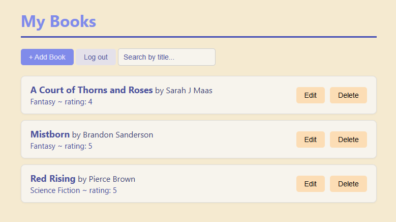

# Book Collection

A full-stack app for managing a
personal book library. Each user registers,
logs in, and sees only their books.



## Features

- Register and log in, with passwords hashed with Argon2 and sessions handled with JWTs
- Per-user collections: every query is scoped to the logged-in user
- Add, edit and delete books, with a confirmation before deleting
- Live search by book title
- Searchable, scrollable genre picker, validated on the backend
- Error banner showing messages from the API

## Tech stack

- **Backend:** Python, FastAPI, Pydantic, psycopg 
- **Database:** PostgreSQL
- **Frontend:** plain HTML, CSS, and JavaScript (ES modules)
- **Packaging:** Docker and Docker Compose

## Run it
You need Docker Desktop installed and running.

```
git clone https://github.com/ntomic7/Book-Collection.git
cd Book-Collection
copy .env.example .env      # use "cp" on Mac/Linux
```

Open `.env` and set your own `DB_PASSWORD` and `JWT_SECRET`, then run:

```
docker compose up --build
```

Open http://localhost:8080.

The API docs are at http://localhost:8000/docs.

## Demo accounts

Username - Password 

demo_1 - demo12345

demo_2 - demo12345

The two accounts have different collections, which shows that data is isolated per user. Their books are reset each time the containers start. You can also register your own account.

## Project structure

```
backend/    FastAPI app (main.py, auth.py, models.py, genres.py, database.py, seed.py)
frontend/   static site, split into JS modules under js/
db/         schema.sql, run automatically when the database is first created
```

## Design notes

- **Authentication:** passwords are hashed with Argon2. Login returns a signed JWT that expires after 60 minutes, and every book route reads the user id from the verified token, never from the request body.
- **Authorization:** book queries include `AND user_id = ...`, so asking for another user's book returns 404.
- **Database:** the schema enforces rating bounds with a `CHECK` constraint and links books to users with a foreign key.
- **Token storage:** the token lives in `localStorage`. That's simple, but an XSS bug could expose it. HttpOnly cookies would be the more secure choice for production.
